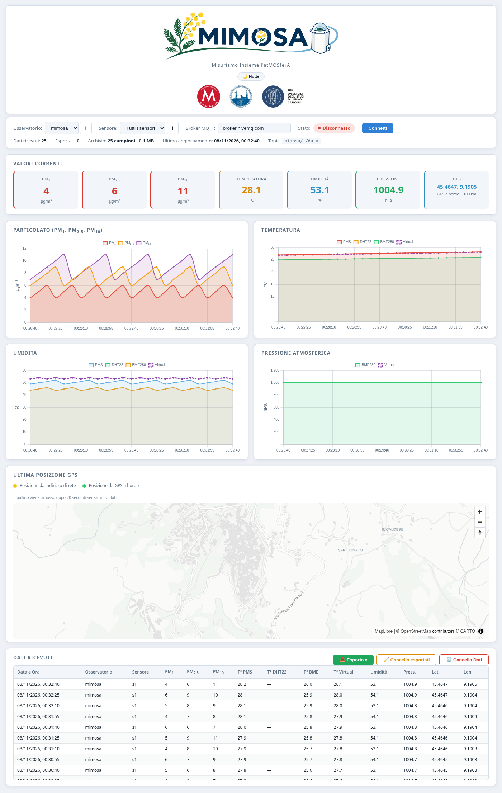

<div align="center">
  
  <br><br>
  <h1>MIMOSA</h1>
  <p><strong>Misuriamo Insieme l'atMOSferA</strong></p>
  <p>
    Dashboard web per la qualità dell'aria in tempo reale<br>
    Riceve dati via MQTT da sensori MIMOSA su Raspberry Pi
  </p>
  <p>
    
    
    
    
    
  </p>
</div>

> **In una frase:** scarichi un file, lo apri, si apre una pagina web, premi **Connetti** e vedi i dati del sensore in tempo reale. I campioni vengono salvati dal server in un **archivio locale SQLite**, quindi restano disponibili anche dopo aver chiuso il browser.

---

## Anteprima



> Video demo: [res/demo.mp4](res/demo.mp4) — panoramica della dashboard in azione con dati in tempo reale.

---

## 1. Cosa serve (requisiti)

- Un PC con **Windows, macOS o Linux**.
- Un **browser moderno** (Chrome, Edge, Firefox o Safari).
- Una **connessione a internet**: grafici e mappa si caricano da CDN online.
  Il collegamento al broker MQTT è fatto dal server locale. Senza internet la
  pagina si apre, ma grafici e mappa potrebbero non comparire.
- Spazio su disco per il **database dell'archivio** (file `mimosa.db`).
- *(solo se compili dal codice sorgente)* **Go 1.26 o superiore**.

Non serve installare nulla: MIMOSA è un **singolo eseguibile** che contiene già
pagina web, stile, script e immagini. Lo storico dei dati è un normale file
SQLite creato accanto all'eseguibile.

---

## 2. Download e avvio in 3 passi

### Passo 1 — Scarica il file giusto

Dalla pagina [**Releases**](https://github.com/Paolo-Comper/mimosa-dashboard/releases):

| Il tuo computer                       | File da scaricare          |
| ------------------------------------- | -------------------------- |
| Windows (Intel/AMD, 64 bit)           | `mimosa-windows-amd64.exe` |
| Linux (Intel/AMD, 64 bit)             | `mimosa-linux-amd64`       |
| Mac con processore **Intel**          | `mimosa-darwin-amd64`      |
| Mac con processore **Apple (M1/M2/M3)** | `mimosa-darwin-arm64`    |

> Non sai quale Mac hai? Menu  → **Informazioni su questo Mac**: se vedi "Chip Apple" scarica `arm64`, se vedi "Intel" scarica `amd64`.

### Passo 2 — Avvialo

**Windows**
1. Rinomina il file scaricato in `mimosa.exe` (facoltativo ma comodo).
2. Doppio click.
3. Se appare l'avviso di Windows SmartScreen: **Ulteriori informazioni** → **Esegui comunque**.

**macOS**
1. Apri il Terminale nella cartella del file e digita:
   ```bash
   chmod +x mimosa-darwin-arm64      # oppure mimosa-darwin-amd64
   ./mimosa-darwin-arm64
   ```
2. Se macOS blocca l'app: tasto destro sul file → **Apri** → **Apri**, oppure:
   ```bash
   xattr -d com.apple.quarantine mimosa-darwin-arm64
   ```

**Linux**
```bash
chmod +x mimosa-linux-amd64
./mimosa-linux-amd64
```

### Passo 3 — Usa la dashboard

Il browser si apre da solo su **http://localhost:8080** (se non succede, aprirlo a mano).

1. **Osservatorio**: lascia `mimosa` (o premi **+** per aggiungerne uno).
2. **Sensore**: scegli il tuo sensore, oppure `Tutti i sensori`.
3. **Broker MQTT**: host del broker (TCP, porta `1883`) oppure un URL esplicito
   `tcp://host:porta`, `ssl://host:8883`, `ws://host:porta/percorso`,
   `wss://host:porta/percorso`. È il **server MIMOSA** a collegarsi al broker,
   non il browser. Il valore viene ricordato; se lo cambi mentre sei connesso,
   premi di nuovo **Connetti**.
4. Premi **Connetti**.

I dati compaiono nella tabella, nei grafici e sulla mappa, e vengono salvati in
`mimosa.db` (vedi [punto 10](#10-dove-sono-salvati-i-dati-sqlite)).

> Se non arriva nulla, controlla che il sensore pubblichi sul topic
> `{osservatorio}/{sensore}/data` (es. `mimosa/rpi-zero-1/data`).
> Per una prova immediata senza sensore vedi il [punto 4](#4-non-ho-un-sensore-dati-di-test).

Per fermare MIMOSA: torna al Terminale/finestra nera e premi **Ctrl + C**.
I dati già ricevuti restano nel database.

---

## 3. La schermata in breve

- **Valori correnti**: PM1, PM2.5, PM10, temperatura, umidità, pressione, GPS.
- **Grafici**: particolato, temperatura, umidità, pressione.
- **Mappa**: ultima posizione GPS (presa da `virtual_gps`): 🟡 giallo = posizione da indirizzo di rete, 🟢 verde = posizione da GPS a bordo. Si aggiorna solo quando cambiano le coordinate.
- **Tabella**: storico dei dati, filtrabile per osservatorio e sensore.
- **Archivio**: numero di campioni e spazio occupato dal database SQLite.
- **🌙 Notte / ☀️ Giorno**: cambia tema. Il tema **predefinito è quello chiaro** e la scelta viene ricordata.
- **📥 Esporta**: scarica **tutto lo storico** della selezione in CSV e/o JSON.
- **🧹 Cancella esportati**: elimina dal database solo i dati già esportati.
- **🗑️ Cancella Dati**: svuota tutto lo storico.

I campioni sono salvati in un **database SQLite** dal server (`mimosa.db`):
restano anche chiudendo il browser, ricaricando la pagina o cambiando PC (basta
portarsi dietro il file). Il browser conserva solo le preferenze (broker,
osservatori, sensori, tema).

---

## 4. Non ho un sensore: dati di test

MIMOSA può pubblicare da sé dei dati di prova (simili a quelli di un sensore reale):

```bash
# Pubblica in continuo (ogni 2 secondi) finché non premi Ctrl+C
./mimosa --test --sensore rpi-zero-1

# Pubblica 50 messaggi e poi si ferma
./mimosa --test --sensore rpi-zero-2 --count 50

# Parametri completi
./mimosa --test --sensore rpi-zero-1 --osservatorio mimosa \
           --broker broker.hivemq.com --count 20
```

Mentre i messaggi vengono pubblicati, apri la dashboard e premi **Connetti**.
Il server deve essere collegato allo **stesso broker** usato da `--test`; i dati
di prova finiscono nello stesso archivio SQLite dei dati reali.

| Opzione          | Obbligatoria?              | Default                 |
| ---------------- | -------------------------- | ----------------------- |
| `--sensore`      | **Sì**, con `--test`       | —                       |
| `--osservatorio` | no                         | `mimosa`                |
| `--broker`       | no                         | `broker.hivemq.com`     |
| `--count`        | no                         | **infinito** (Ctrl+C)   |

Il topic pubblicato è `{osservatorio}/{sensore}/data`.

> Valgono ancora le vecchie sintassi `./mimosa --test rpi-zero-1 5`
> (sensore e numero di messaggi in posizione).

---

## 5. Comandi rapidi (cheat sheet)

| Comando                                                          | Cosa fa                                        |
| ---------------------------------------------------------------- | ---------------------------------------------- |
| `./mimosa`                                                       | Avvia la dashboard                             |
| `./mimosa --dev`                                                 | Avvia leggendo i file da disco (sviluppo)      |
| `./mimosa --help`                                                | Mostra l'aiuto                                 |
| `./mimosa --test --sensore NOME`                                 | Pubblica dati di test in continuo              |
| `./mimosa --test --sensore NOME --count 10`                      | Pubblica 10 messaggi di test                   |
| `./mimosa --db archivio.db`                                      | Usa un database SQLite diverso                 |
| `PORT=9090 ./mimosa`                                             | Usa la porta 9090 invece di 8080               |

> Su Windows sostituisci `./mimosa` con `mimosa.exe` e `PORT=9090 ./mimosa` con
> `set PORT=9090 && mimosa.exe` (Prompt dei comandi) oppure `$env:PORT=9090; .\mimosa.exe` (PowerShell).

---

## 6. Formato dati MQTT

**Topic:** `{osservatorio}/{sensore}/data` — esempio `mimosa/rpi-zero-1/data`

> L'osservatorio può contenere più livelli e anche iniziare con `/` (es.
> `/uniurb/aserpieri/test/marconi0/esp32-d0ac78/data`): la dashboard prende
> come sensore l'ultimo livello prima di `data` e come osservatorio tutto il
> resto.

I messaggi ricevuti dal server vengono salvati **così come arrivano** (JSON)
nella tabella `campioni` del database SQLite; `osservatorio`, `sensore` e
`timestamp` sono estratti e indicizzati per filtri, conteggi ed export.

```json
{
  "timestamp": 1771815991.22558,
  "pms":       { "pm1": 4, "pm25": 10, "pm10": 15, "temperature": 9.1, "humidity": 63.3 },
  "dht22":     { "temperature": 4.9, "humidity": 81.1 },
  "bme280":    { "temperature": 4.3, "humidity": 74.2, "pressure": 999.57 },
  "virtual":   { "temperature": 4.6, "humidity": 76.5, "pressure": 999.62 },
  "gps":       { "lat": 43.72386, "lon": 12.63765, "alt": 472.0, "sats": 7, "valid": true }
}
```

### Il ramo `virtual`

`virtual` è un valore **calcolato/fuso** (es. media o correzione dei sensori
fisici). È **facoltativo** e ha la **massima precedenza** su temperatura,
umidità e pressione: quando è presente prevale sugli altri rami.

L'ordine di precedenza usato dalla dashboard è:

```
temperatura / umidità:   virtual  >  bme280  >  dht22  >  pms
pressione:               virtual  >  bme280
```

> La pressione può essere inviata sia in **hPa** (~1000, come negli esempi)
> sia in **Pa** (~100000): la dashboard riconosce l'unità dalla grandezza del
> valore e mostra sempre hPa, sia per `bme280` che per `virtual`.

- **Valori correnti** e le colonne **Umidità** / **Press.** della tabella
  mostrano il primo valore disponibile nell'ordine di precedenza (con
  `virtual` in cima).
- Nei grafici **Temperatura**, **Umidità** e **Pressione**, `virtual` è
  tracciato come serie dedicata (linea viola tratteggiata) insieme ai sensori
  fisici.
- Se `virtual` non è presente nel messaggio, la dashboard usa normalmente i
  sensori fisici. Non è obbligatorio inviarlo.

### La posizione GPS: `virtual_gps` e `gps`

I firmware nuovi inviano la posizione "fusa" nel ramo **`virtual_gps`**, che ha
la precedenza; il ramo `gps` resta supportato per i firmware vecchi.

```json
{
  "virtual_gps": {
    "lat": 45.4642, "lon": 9.18998, "alt": 200.0,
    "valid": true, "source": "network", "sats": null,
    "GPS_HW_POS": 1, "accuracy_m": 100000.0,
    "datetime_utc": "2026-11-07T23:39:17Z", "timestamp": 1794094757
  },
  "gps_network": { "lat": 45.4642, "lon": 9.18998, "alt": 200.0, "source": "ip", "accuracy_m": 100000.0 },
  "gps": { "lat": null, "lon": null, "valid": false }
}
```

Sulla mappa viene proiettata la posizione di `virtual_gps`, con questo colore:

| `GPS_HW_POS`     | Pallino sulla mappa        |
| ---------------- | -------------------------- |
| `1`              | 🟡 giallo (posizione da indirizzo di rete) |
| `0`              | 🟢 verde (posizione da GPS a bordo) |
| `null` / assente | nessun pallino             |

Se non arrivano nuovi dati per **20 secondi**, il pallino viene tolto dalla
mappa: la posizione non è più considerata aggiornata.

La scheda GPS, le colonne Lat/Lon della tabella e l'esportazione usano la stessa
posizione (con sorgente e accuratezza in metri/km).

Esempio di messaggio minimo con solo `virtual` e particolato:

```json
{
  "timestamp": 1771815991.22558,
  "pms":     { "pm1": 4, "pm25": 10, "pm10": 15 },
  "virtual": { "temperature": 4.6, "humidity": 76.5, "pressure": 999.62 }
}
```


### Collegare un sensore reale (es. Raspberry Pi)

1. Il sensore pubblica su `{osservatorio}/{sensore}/data`
   (es. `mimosa/rpi-zero-1/data`).
2. Apri la dashboard, seleziona **Osservatorio** e **Sensore** e premi **Connetti**.
3. Usa il pulsante **+** accanto ai menu (o doppio click sul menu Sensore) per
   aggiungere osservatori/sensori personalizzati: restano memorizzati nel browser.

---

## 7. Esportazione dati

Il pulsante **📥 Esporta** scarica **tutto lo storico** della selezione corrente
(osservatorio/sensore), non solo gli ultimi 50 campioni mostrati in tabella.
Scegli CSV e/o JSON e premi **⬇️ Scarica selezionati**.

I file vengono generati dal server leggendo direttamente SQLite, in streaming:
non c'è più il limite di 5.000 righe e non serve tenere tutto in memoria.

| Formato  | Uso tipico                  |
| -------- | --------------------------- |
| **CSV**  | Excel, LibreOffice, analisi |
| **JSON** | Elaborazioni programmatiche |

I record scaricati vengono marcati come **esportati** (contatore "Esportati" e
riga evidenziata in tabella):

- **🧹 Cancella esportati** elimina dal database solo i dati già esportati e
  lascia intatti quelli arrivati nel frattempo.
- **🗑️ Cancella Dati** svuota invece tutto lo storico.

> L'export è anche il modo più semplice per fare un **backup** dei dati:
> scarica il CSV/JSON prima di cancellare o cambiare computer.

---

## 8. Compilare dal codice sorgente

Serve **Go 1.26+**. L'archivio usa SQLite in **puro Go**
(`modernc.org/sqlite`): non serve CGO e il cross-compile con `CGO_ENABLED=0`
funziona come prima.

```bash
git clone https://github.com/Paolo-Comper/mimosa-dashboard.git
cd mimosa-dashboard
go build -o mimosa .
./mimosa
```

Per creare i file delle release per tutte le piattaforme:

```bash
mkdir -p dist
CGO_ENABLED=0 GOOS=linux   GOARCH=amd64 go build -trimpath -ldflags "-s -w" -o dist/mimosa-linux-amd64 .
CGO_ENABLED=0 GOOS=windows GOARCH=amd64 go build -trimpath -ldflags "-s -w" -o dist/mimosa-windows-amd64.exe .
CGO_ENABLED=0 GOOS=darwin  GOARCH=amd64 go build -trimpath -ldflags "-s -w" -o dist/mimosa-darwin-amd64 .
CGO_ENABLED=0 GOOS=darwin  GOARCH=arm64 go build -trimpath -ldflags "-s -w" -o dist/mimosa-darwin-arm64 .
```

Test della logica:

```bash
go test ./...                 # backend Go (parsing, DB, export)
node tests/logica.test.js     # logica della dashboard (Node)
```

---

## 9. Problemi comuni

| Problema | Soluzione |
| -------- | --------- |
| La pagina si apre ma **grafici e mappa non compaiono** | Serve internet: grafici e mappa sono caricati da CDN online. |
| **Il browser non si apre da solo** | Vai a `http://localhost:8080` a mano. |
| **"Porta 8080 occupata"** | MIMOSA libera la porta da sola; se persiste usa un'altra porta: `PORT=9090 ./mimosa`. |
| **Non arrivano dati** | Premi **Connetti** e controlla broker e topic `{osservatorio}/{sensore}/data`. |
| **Connesso ma "Dati ricevuti: 0"** | Il topic ricevuto non corrisponde a osservatorio/sensore selezionati: controlla il topic mostrato nella barra. Sono supportati anche topic con più livelli e con `/` iniziale (es. `/uniurb/.../data`). |
| **Errore di connessione al broker** | Il server usa MQTT **TCP** (porta `1883`). Se la rete blocca la 1883 usa `ssl://host:8883` (TLS) oppure `ws://host:porta/percorso` / `wss://host:porta/percorso` (WebSocket). Controlla host, porta e firewall. |
| **Windows: il firewall chiede il permesso** | Accetta (serve per la porta locale). |
| **La mappa è grigia / non si carica** | Serve internet; attendi qualche secondo dal primo avvio. |
| **Il database non si apre / "database is locked"** | Assicurati di avere i permessi di scrittura sulla cartella di `mimosa.db` e non avviare due istanze di MIMOSA sullo stesso file. |
| **Dati vecchi con nomi strani** | I campioni del vecchio storage del browser vengono importati automaticamente una volta al primo avvio; se l'import non riesce viene ritentato al successivo. |

---

## 10. Dove sono salvati i dati (SQLite)

Di default il server crea il database **`mimosa.db`** nella cartella da cui viene
avviato il binario; si può cambiare con `--db FILE` (es. `./mimosa --db
archivio-2026.db`). I file `mimosa.db-wal` e `mimosa.db-shm` sono di appoggio e
appartengono al database.

- **Cosa contiene**: ogni messaggio MQTT ricevuto viene salvato come JSON nella
  tabella `campioni`, con osservatorio, sensore, timestamp e flag "esportato".
  Non c'è più il limite di 5.000 campioni: il limite è lo spazio su disco.
- **Backup**: il file cresce con i dati, quindi conviene salvarlo ogni tanto.
  Ferma MIMOSA (Ctrl+C) e copia il database:
  ```bash
  # Linux / macOS
  cp mimosa.db mimosa-backup-$(date +%F).db
  # Windows (Prompt dei comandi)
  copy mimosa.db mimosa-backup.db
  ```
  Se accanto ci sono `mimosa.db-wal` e `mimosa.db-shm`, copiali insieme al
  database. In alternativa, scarica CSV/JSON dalla dashboard: è un backup
  completo dei dati ed è leggibile anche senza MIMOSA.
- **Cancellare lo storico**: usa **🗑️ Cancella Dati**, oppure ferma il programma
  ed elimina `mimosa.db`.
- **Ripristino**: rimetti il file `mimosa.db` accanto al binario e riavvia.
- **Migrazione**: se stai arrivando da una versione precedente, i campioni che
  erano in `localStorage` vengono importati automaticamente al primo avvio.
- **API locale**: la dashboard usa `http://localhost:8080/api/...`
  (`/api/status`, `/api/samples`, `/api/stats`, `/api/export`, `/api/import`).
  Il server è pensato per l'uso locale e non ha autenticazione: non esporlo su
  una rete non fidata.

---

## Licenza

[MIT](LICENSE)
